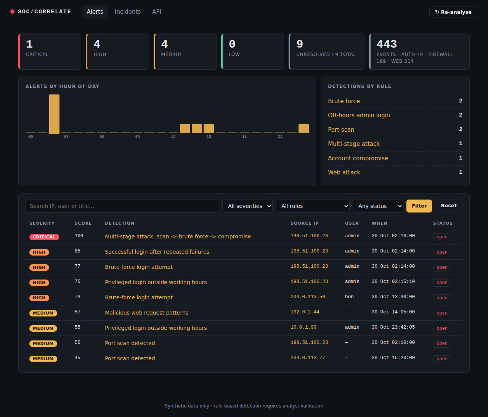
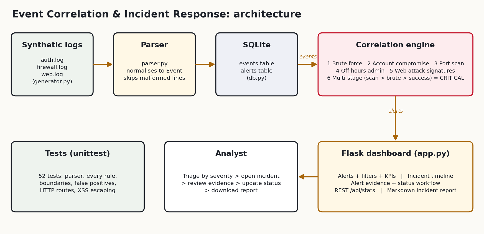
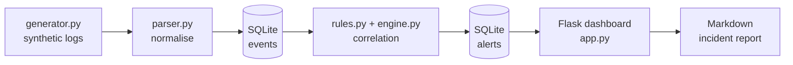

# Intelligent Security Event Correlation & Incident Response Dashboard

**Level 2 Internship Project · Software, AI & Cybersecurity · Project 01**

A lightweight SIEM-style tool that ingests multiple log sources, correlates events with
rule-based detections, scores severity, and presents prioritised incidents in a web dashboard
with evidence, a triage workflow and exportable incident reports.

> **Safety & scope:** all data is **synthetic**. Logs are produced by `siem/generator.py` using
> fictional users and RFC 1918 / RFC 5737 documentation IP ranges. Nothing here scans, attacks or
> touches a real system.



## Features

| Requirement (from the catalog) | Implementation |
|---|---|
| Collect multiple security log sources | `auth`, `firewall` and `web` logs parsed into one normalised `Event` model |
| Correlate events | 5 single-source rules + a cross-rule **multi-stage** correlation rule |
| Prioritise suspicious activity | 0–100 severity score → Low / Medium / High / Critical |
| Incident dashboard | Flask UI: KPIs, hourly chart, filters/search, incident timeline, evidence viewer, status workflow |
| Safe simulated detections | Deterministic generator with planted attacks **and** benign decoys |
| Incident reports | One-click Markdown report per incident (`/incidents/<ip>/report.md`) |

## Architecture





```
siem-dashboard/
├── app.py                 Flask application (routes, filters, report download, JSON API)
├── run_demo.py            One command: generate → ingest → correlate → sample report
├── siem/
│   ├── models.py          Event / Alert dataclasses, severity mapping
│   ├── parser.py          Log line → Event (rejects malformed input safely)
│   ├── db.py              SQLite schema and queries
│   ├── rules.py           Detection rules + tunable thresholds
│   ├── engine.py          Runs all rules, persists alerts (idempotent)
│   ├── generator.py       Synthetic log generator with ground-truth scenarios
│   └── reporting.py       Incident report builder
├── templates/ static/     Dashboard UI
├── tests/                 52 unit + integration tests
└── docs/                  Architecture, screenshots, test results, sample report, slides
```

## Quick start

Requires Python 3.9+.

```bash
python -m venv .venv && source .venv/bin/activate      # Windows: .venv\Scripts\activate
pip install -r requirements.txt
python run_demo.py        # generates logs, ingests, correlates, writes a sample report
python app.py             # open http://127.0.0.1:5000
```

Run the tests (no extra packages needed; `pytest` also works if you have it):

```bash
python -m unittest discover -s tests -t . -v
```

## Detection rules

All thresholds are constants at the top of `siem/rules.py`.

| # | Rule | Logic | Score |
|---|---|---|---|
| 1 | **Brute force** | ≥ 5 failed logins from one IP within 120 s (continuing attacks merge into one alert) | 70–85 |
| 2 | **Account compromise** | Successful login after ≥ 3 failures from the same IP within 5 min | 85 |
| 3 | **Port scan** | ≥ 10 distinct destination ports from one IP within 60 s | 40–70 |
| 4 | **Off-hours admin** | `admin`/`root` login outside 08:00–18:00; external IP scores higher | 55 / 75 |
| 5 | **Web attack** | SQL-injection, path-traversal or XSS patterns in (URL-decoded) request paths | 45–60 |
| 6 | **Multi-stage** | Port scan → brute force → successful login from the *same IP* within 1 h per stage | **100 (Critical)** |

Each alert carries a MITRE ATT&CK technique reference and links to the exact log events that
triggered it (the *evidence*).

## Demo walkthrough

`run_demo.py` plants these scenarios (ground truth in `siem/generator.py`):

| Scenario | Source IP | Expected result |
|---|---|---|
| Scan → brute force → login as `admin` at 02:15 | 198.51.100.23 | **Critical** multi-stage incident (+ 4 contributing alerts) |
| 8 failed logins against `bob`, never succeeds | 203.0.113.50 | High brute force only |
| 15-port scan | 203.0.113.77 | Medium port scan only |
| SQLi / traversal / XSS requests | 192.0.2.44 | Medium web attack |
| Internal admin login at 23:42 | 10.0.1.99 | Medium off-hours |
| *Decoy:* 3 failures spread over 30 min | 203.0.113.9 | **No alert** |
| *Decoy:* a user mistypes twice then logs in | 10.0.1.11 | **No alert** |

Suggested demo flow: dashboard → click **Critical** KPI → open the incident timeline for
`198.51.100.23` → inspect evidence → mark an alert *investigating* → download the report.

Screenshots are in `docs/screenshots/`; a generated example is in `docs/sample_incident_report.md`.

## Testing

`docs/test_results.txt` holds the full run. **52 tests, all passing**:

* **Parser (5):** valid lines for each source; 8 kinds of malformed input; skipped-line counting.
* **Rules (30):** every rule at, below and above its threshold; window expiry; IP isolation;
  boundary hours; URL-encoded attacks; multi-stage with missing/misordered/cross-IP stages.
* **Integration (17):** full generator → DB → correlation pipeline against ground truth,
  **no false positives on decoys**, exactly one Critical, idempotent re-analysis, evidence
  integrity, HTTP routes, filters, status workflow, 404/400 handling, report download,
  and a stored-XSS check proving log content is HTML-escaped in the UI.

## Limitations (honest list)

* **Rule-based only.** No statistical or ML anomaly detection; thresholds are static and
  would need tuning on real traffic.
* **Batch, not streaming.** Logs are ingested from files and analysed on demand
  (the *Re-analyse* button), not tailed in real time.
* **Simplified log formats.** Real Wazuh/OpenSearch, syslog or Windows event formats would
  need dedicated parsers. Wazuh and OpenSearch were deliberately not used to keep the
  project self-contained and reproducible.
* **Per-IP correlation.** Attackers rotating IPs, NAT, and shared proxies are not handled;
  incidents are grouped by source IP.
* **Signature matching for web attacks** is simple substring matching and can produce
  false positives/negatives (e.g. a path containing `--`).
* **No authentication or CSRF protection** on the dashboard; it is intended to run locally,
  not be exposed to a network. SQLite is not suited to high event volumes.
* **Timestamps** are treated as naive local times; no timezone normalisation across sources.

## Future work

Real-time log tailing, GeoIP/threat-intel enrichment, rule configuration via UI, ML-based
baseline anomaly scoring, authentication, and OpenSearch/Wazuh connectors.

## Contribution

Replace this section with your name and a short note on what you built, tested and documented.
